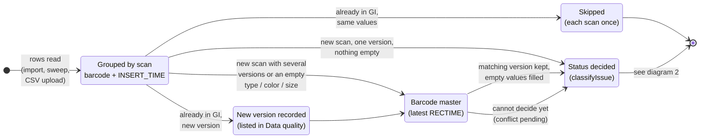
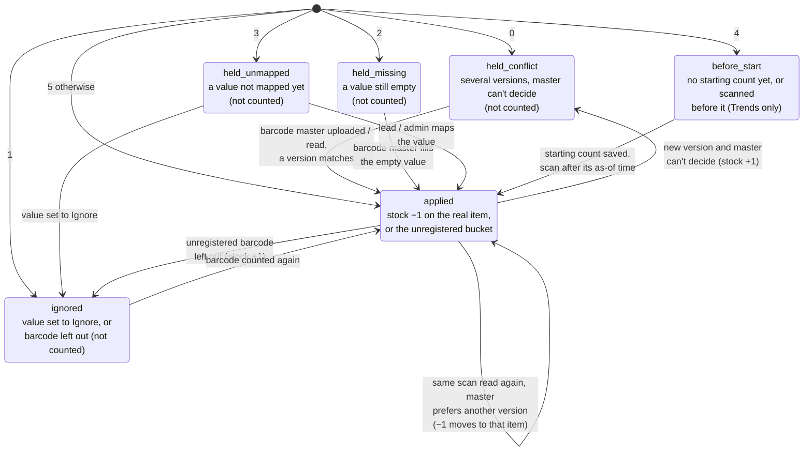

# How GI processes scan data

Two state diagrams of the issue import (code: `backend/gi/importing/importer.py`, `classify.py`, `master.py`).
Requirements: URD ORA-02, ORA-05, ORA-14, ORA-15, DQ-03, rule 7.8. Design: [BUILD_PLAN.md](./BUILD_PLAN.md) §3.

## 1. From Oracle rows to a scan

Rows arrive from the regular import, the daily sweep or a CSV upload. All rows of one scan (same `SUIT_BARCODE` and
`INSERT_TIME`) are handled together.

- **Barcode master**: GI's copy of the latest version (highest `RECTIME`) of each barcode. With an Oracle connection
  GI asks Oracle first; otherwise it uses the last upload (Settings › Import).
- **New version recorded**: a scan already in GI comes back with other values. Only versions not seen before are
  recorded and reported.

## 2. Status of a stored scan

The first status is chosen by checks in a fixed order (the numbers on the arrows from the start; the first match
wins). Later events move a scan between statuses; each move is one transaction and writes the matching stock change.

| Status | Counted in stock | Counted in Trends | Waits for |
|---|---|---|---|
| `held_conflict` | no | no | a barcode master upload or read with a matching version |
| `held_missing` | no | no | the barcode master to fill the empty type / color / size (an empty `SUIT_LEVEL` cannot be filled) |
| `held_unmapped` | no | no | the lead or admin to map the value (Settings › Oracle values) |
| `ignored` | no | no | — (a left-out unregistered barcode can be counted again) |
| `before_start` | no | yes | the location's starting count, if the scan is after its as-of time |
| `applied` | yes (−1) | yes | — |

Notes:
- When a waiting scan is decided again, it goes through the same checks from the start, so it can also land in
  `held_unmapped`, `ignored` or `before_start`; the diagram shows the usual outcome.
- A `before_start` scan earlier than the starting count's as-of time never changes again.
- Changing an existing value mapping affects new scans only; scans already `applied` or `ignored` by it stay as they are.
- Every stock change is a new ledger entry; nothing is edited. A scan that stops counting gets +1, dated at the scan time.
